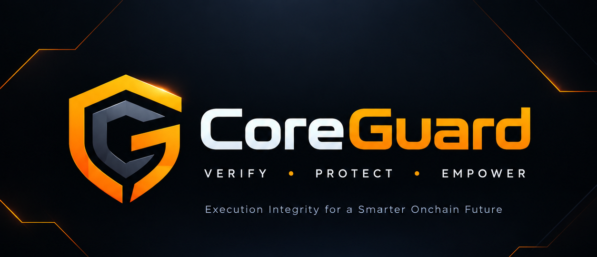

<div align="center">

<picture>
  <source media="(prefers-color-scheme: dark)" srcset="brand/coreguard-banner-dark.png">
  
</picture>

# CoreGuard Roadmap

### From verified execution to the trust layer every Stellar agent runs on.

<sub><b>VERIFY</b> &nbsp;•&nbsp; <b>PROTECT</b> &nbsp;•&nbsp; <b>EMPOWER</b></sub>

[**Website**](https://coreguard-trust-and-defense.lovable.app/) · [**Stellar**](https://coreguard-trust-and-defense.lovable.app/stellar) · [**Investors**](https://coreguard-trust-and-defense.lovable.app/investors) · [**README**](README.md) · [**Live status**](docs/STATUS.md)

</div>

---

| ✅ Shipped & evidenced | 🟠 Built · offline / DRY_RUN | ⏳ Planned | 🔒 Owner-gated |
|:--:|:--:|:--:|:--:|

> Requested funding is **not** awarded funding. No signed commercial pilot yet — one **independent external technical reproduction** is public ([ACP #328](https://github.com/agentic-commerce-protocol/agentic-commerce-protocol/discussions/328)). `VERIFIED ≠ SAFE`.

---

## Three phases — dates, deliverables, acceptance

Investor-facing detail and budget: [COREGUARD-INVESTMENT-READINESS.md](COREGUARD-INVESTMENT-READINESS.md).

| Phase | When (from award) | Ships | Accepted when |
|---|---|---|---|
| **1 · Productise** | Months 1–2 | SDK v1 with a measured 15-minute quickstart; Soroban `commit_authorized` deployed to testnet from CI-built wasm, with TTL/archival policy and a read-back artifact | A new developer reaches `PASS`/`BLOCK` in ≤ 15 minutes with the transcript committed; the deploy + authorized commit + named refusal are reproducible from committed bytes |
| **2 · Prove with outsiders** | Month 3 | Two scoped two-week pilots — one DEX/wallet, one AI-agent payments — each with a published report including failures | Two external teams ran their own flow; at least one paid engagement or signed LOI |
| **3 · Institutional readiness** | Month 4 | Independent security review closed with remediation; enterprise policy pack (multi-approval, spend limits, audit export); SLA and pricing published | A non-CoreGuard operator verifies a receipt from public artifacts only |

Nothing in phase 2 or 3 is claimed as started: no pilot is signed and no review is engaged.

## 🟢 External reproduction — a machine that had never touched this kit

> **19 Nov 2026 · public record:** [ACP discussion #328](https://github.com/agentic-commerce-protocol/agentic-commerce-protocol/discussions/328)

An outside payments team — **AgentBadge** (buidl25) — reported an independent run of the VAR/1 pilot kit on a machine that had never touched it: **15/15 rows, exit 0, run twice**, with a byte-identical seeded receipt on a Node runtime outside our tested set. The same public report names one **disagreeing row**: an identical rerun into the same `outDir` reopens a ledger that already recorded the spend, so 3 rows fail on the second run — a real kit limitation, documented rather than hidden. The **AER-1 team** reviewed the model separately in the same thread; that is standards feedback, not a trial, and their name is not attached to the external run.

| Signal | Result | Source |
|---|:--:|---|
| Pilot-kit rows on a fresh clone, run twice | **15 / 15 · exit 0** | [external report](https://github.com/agentic-commerce-protocol/agentic-commerce-protocol/discussions/328#discussioncomment-19722647) |
| Seeded receipt across the reporter's runs | **byte-identical** | [seeded run](https://github.com/agentic-commerce-protocol/agentic-commerce-protocol/discussions/328#discussioncomment-19750155) |
| Same-`outDir` rerun (reported disagreement) | **12 / 15** — stateful spend rows | same report |
| AER-1 team review in the same thread | **standards feedback, not a trial** | [ACP #328](https://github.com/agentic-commerce-protocol/agentic-commerce-protocol/discussions/328) |
| AER-1 × VAR/1 outcome mapping agreed in public | **5 outcomes mapped** | [mapping note](https://github.com/coreguard-global/CoreGuard/blob/main/docs/aer1-var1-outcome-mapping.md) |

**What shipped in that window (our work, not the reporter's):** `VAR/1` one-command pilot kit · `CG-OUT/1` outcome layer (five outcomes; `ABSENT` / `NOT_CHECKED` never travel as a block) · `CG-ID/1` record identity split · AER-1 parser + full 72-file corpus run · `CG-ANCHOR/1` own anchor service + `CG-COMPOSE/1` composition policy · Agent Commerce discovery, key trust, spend ledger and payment policy · two-column corpus vectors (`present-consistent-nonconforming`, `anchor-unresolvable`).

> **Scope, stated plainly:** this is an independent *technical reproduction* of our open kit by an outside payments team (AgentBadge). It is **not** a commercial pilot, customer, partnership, audit or endorsement, and it is **not** an AER-1 trial. `VERIFIED ≠ SAFE`.

**Founder:** [EslaM HeshAM (MR-X)](https://coreguard-trust-and-defense.lovable.app/founder) · Website: [coreguard-trust-and-defense.lovable.app](https://coreguard-trust-and-defense.lovable.app)

---

## 1 · Where we stand — 17 Nov 2026

| Area | Milestone | Status |
|---|---|:--:|
| **Core DAO** | EvidenceRegistry anchor on Mainnet + verified agent execution · 43/43 Foundry proofs | ✅ |
| **Stellar** | SOROBAN/1 commitment anchor on Mainnet + first `commit()` call (ledger 65,337,373) | ✅ |
| **Stellar** | First signed funded swap gated by DEX-GATE/1 — **ledger 65,338,112** | ✅ |
| **Stellar** | PSAR/1 pre-sign authorization receipts · Freighter technical comment posted | 🟠 wallet integration not built |
| **Agent Commerce** | Phase 2: AC-FW/1 · CGCR/1 · AGR/1 · AC-CS/1 — 1841/1841 tests on `main` | 🟠 synthetic fixtures |
| **Stellar** | CGXA-SOROBAN/1 consent binding · ESCROW/1 bounty escrow · TRINITY/1 cross-network model | 🟠 no broadcast |
| **Pi Network** | Execution-truth plan | 🟠 DRY_RUN / PLAN_ONLY |

---

## 2 · The funded path — SCF #46, $150,000 requested

```text
 Month 1            Month 2              Month 3                 Month 4
 ───────────        ─────────────        ──────────────          ──────────────
 M1  SDK v1    ──▶  M2  Authorized  ──▶  M3  Two external   ──▶  M4  Institutional
     15-min         lane deployed        pilots + report         readiness
     quickstart     from CI wasm         (failures included)     SLA · pricing
 ───────────        ──────────────────────────────────────       ──────────────
   T1 · $40K                    T2 · $55K                          T3 · $55K
```

| Milestone | Deliverable | Accepted when | Tranche |
|---|---|---|:--:|
| **M1** · Month 1 | SDK v1, measured quickstart, API reference, error-code catalogue | A new developer reaches PASS/BLOCK in ≤ 15 min; transcript committed | **T1 · $40K** |
| **M2** · Month 2 | Soroban `commit_authorized` on testnet from CI wasm; TTL/archival policy | Artifacts show deploy, authorized commit, read-back, named foreign-key refusal | **T2 · $55K** |
| **M3** · Month 3 | One DEX/wallet pilot + one AI-agent payments pilot | Two external teams run their own flows; ≥ 1 paid engagement or signed LOI | **T2** |
| **M4** · Month 4 | Close independent review; enterprise policies, SLA, pricing | Outside operator verifies a receipt from public artifacts only | **T3 · $55K** |

**Use of funds:** engineering $84K · security review $18K · audit retainer $12K · pilot support $12K · infrastructure $6K · legal $6K · docs & DX $6K · contingency $6K — [official budget](docs/SCF-BUILD-APPLICATION-V3.md).

---

## 3 · Next 90 days

| # | Action | Gate | Status |
|:--:|---|---|:--:|
| 1 | Run the [Agent Commerce pilot plan](docs/AGENT-COMMERCE-PILOT-PLAN-2026-11-16.md) with a design partner | Partner needed | ⏳ |
| 2 | Deploy the authorized-lane Soroban instance (Issue #24) | Owner decision | 🔒 |
| 3 | Publish `@coreguard/stellar` to npm | Release credentials + approval | 🔒 |
| 4 | Freighter PSAR/1 proposal review · fail-closed receipt SEP draft (#56) | Stellar maintainers | ⏳ |
| 5 | Engage an external auditor using the drafted scope | Funding | ⏳ |

---

## 4 · Two-week pilot — what a partner gets

| Days | Step | Owner |
|:--:|---|---|
| 1–2 | Choose one flow; capture the exact unsigned envelope and policy fields | Joint |
| 3–5 | Wire `issueAuthorizationReceipt` / `verifyAuthorizationReceipt` behind a flag | Partner · CoreGuard reviews |
| 6–8 | Run real and adversarial cases: amount, destination, expiry, network, replay | Joint |
| 9–10 | Evidence bundle verified outside this repository; report includes failures | CoreGuard |
| 11–14 | Read-out and go / no-go decision | Joint |

Full kit: [docs/PILOT-KIT.md](docs/PILOT-KIT.md)

---

## 5 · Detailed plans

[90-day roadmap](docs/ROADMAP-90-DAYS-2026-11.md) · [4-month plan](docs/ROADMAP-4MONTH.md) · [Production roadmap](docs/PRODUCTION-ROADMAP.md) · [Funding roadmap](docs/funding-roadmap-2026.md) · [Live status](docs/STATUS.md)

---

<div align="center">

| [Fund CoreGuard →](https://coreguard-trust-and-defense.lovable.app/funding) | [Propose a partnership →](https://coreguard-trust-and-defense.lovable.app/partnerships) | [coreguardglobal@gmail.com](mailto:coreguardglobal@gmail.com) |
|:--:|:--:|:--:|

<br>
<sub><b>More than security. It's trust.</b></sub>

</div>
