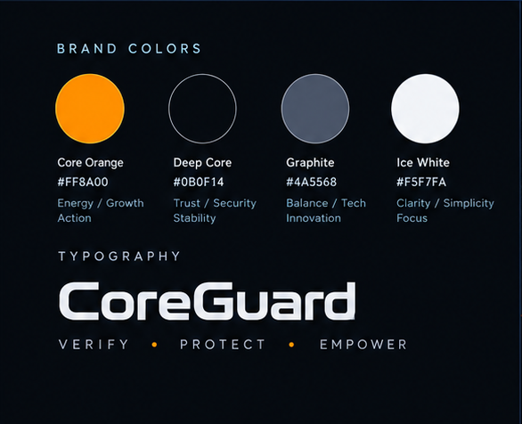

<h1 align="center">CoreGuard Roadmap</h1>

<b>VERIFY • PROTECT • EMPOWER</b> — The Execution Trust Layer for Stellar, live on Core DAO, planned for Pi Network.

> Legend: ✅ shipped & evidenced · 🟠 built, offline / DRY_RUN · ⏳ planned · 🔒 owner-gated. Requested funding is **not** awarded funding. `VERIFIED ≠ SAFE`.

## Where we are (16 Nov 2026)
- ✅ Core DAO Mainnet: EvidenceRegistry anchor + verified agent execution.
- ✅ Stellar Mainnet: SOROBAN/1 commitment anchor and first signed funded swap gated by DEX-GATE/1 (ledger 65,338,112).
- ✅ PSAR/1 pre-sign authorization receipts (wallet integration not built).
- ✅ Agent Commerce Security Phase 2: AC-FW/1 · CGCR/1 · AGR/1 · AC-CS/1 — measured 1724/1724 tests on `main`.
- 🟠 CGXA-SOROBAN/1 consent binding prepared offline · ESCROW/1 bounty escrow mirror · TRINITY/1 cross-network model.
- 🟠 Pi Network: DRY_RUN / PLAN_ONLY.

## SCF #46 request — $150,000 (requested, not awarded)
| Tranche | Amount | Milestones (from the official budget) |
|---|---|---|
| T1 | $40,000 | M1 — SDK v1 + measured 15-minute quickstart, API reference, error-code catalogue |
| T2 | $55,000 | M2 — Soroban `commit_authorized` lane deployed from CI wasm with TTL/archival policy · M3 — two external two-week pilots (DEX/wallet + AI-agent payments) |
| T3 | $55,000 | M4 — independent review findings closed, enterprise policies, SLA, pricing and support boundaries |

## Next 90 days
- ⏳ Run the [Agent Commerce pilot plan](docs/AGENT-COMMERCE-PILOT-PLAN-2026-11-16.md) with a design partner (none signed yet).
- 🔒 Owner decision on deploying the authorized-lane Soroban instance (Issue #24).
- ⏳ Publish `@coreguard/stellar` to npm once release credentials and approval exist.
- ⏳ Freighter PSAR/1 proposal review; fail-closed receipt semantics SEP draft (#56).
- ⏳ External auditor engagement using the drafted auditor scope.

## Detailed plans
[90-day roadmap](docs/ROADMAP-90-DAYS-2026-11.md) · [4-month plan](docs/ROADMAP-4MONTH.md) · [Production roadmap](docs/PRODUCTION-ROADMAP.md) · [Funding roadmap](docs/funding-roadmap-2026.md) · [Live status](docs/STATUS.md) · [Website](https://coreguard-trust-and-defense.lovable.app/)

